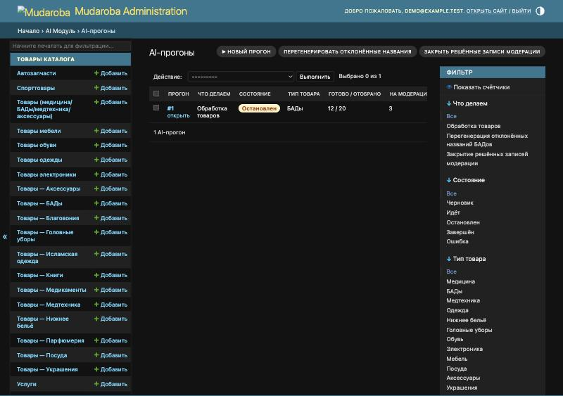
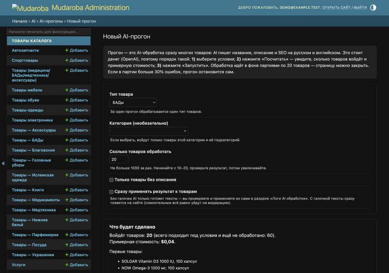
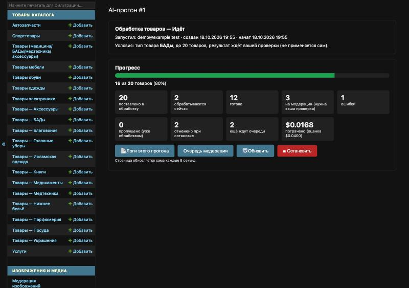
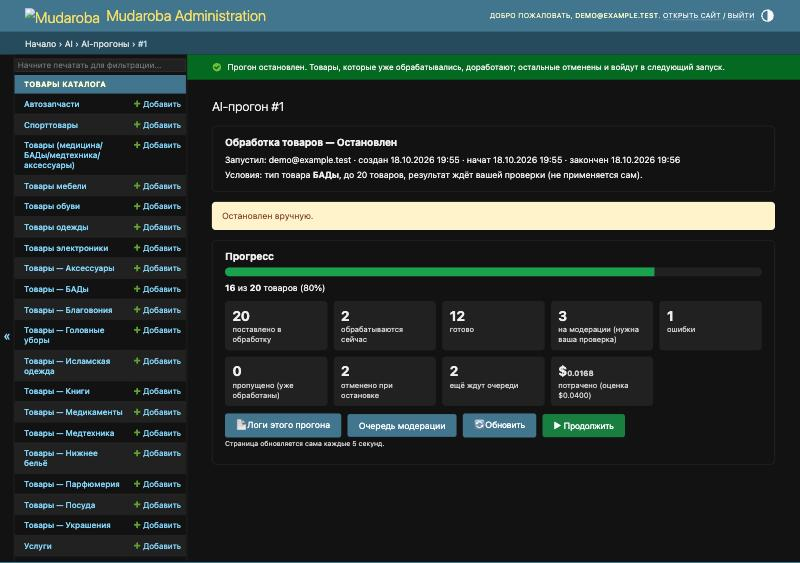
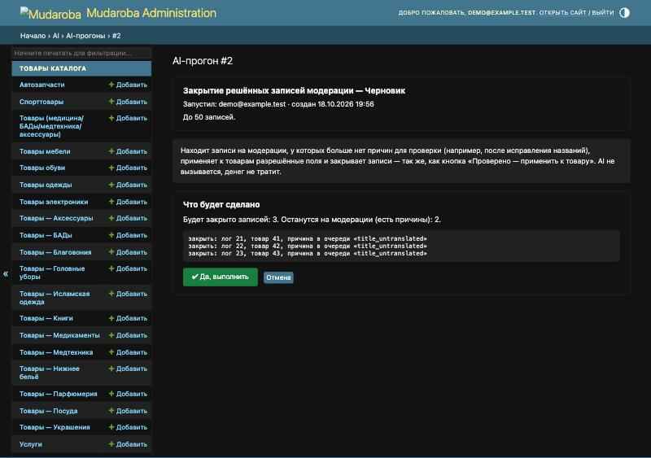

# Как запустить AI-прогон из админки

Пошаговая инструкция для администратора. Консоль и ssh не нужны: всё делается кнопками в разделе **AI → AI-прогоны** (`/admin/ai/airun/`).

**Прогон** — AI-обработка сразу многих товаров: AI пишет название, описание и SEO на русском и английском. Каждая обработка стоит денег (OpenAI), поэтому сначала всегда смотрим, сколько товаров войдёт и сколько это примерно стоит.

## 1. Запустить прогон

1. Откройте **AI → AI-прогоны** и нажмите **«▶ Новый прогон»**.
2. Заполните условия:
   - **Тип товара** — обязательно. Один прогон = один тип (например, «БАДы»).
   - **Категория** — необязательно. Начните печатать название и выберите из списка; войдут товары этой категории и всех её подкатегорий.
   - **Сколько товаров обработать** — не больше 1000 за раз. Для первого раза ставьте 10–20.
   - **Только товары без описания** — если нужны только пустые карточки.
   - **Сразу применять результат к товарам** — без галочки AI только готовит тексты, а вы проверяете и применяете их сами в «Логах AI обработки». С галочкой тексты сразу появятся на сайте (сомнительные всё равно уйдут на модерацию). Первый прогон каждого типа делайте **без** галочки.
3. Нажмите **«🧮 Посчитать»**. Появится блок «Что будет сделано»: сколько товаров войдёт, сколько всего ещё не обработано и примерная стоимость, плюс первые названия.
4. Если всё верно — нажмите **«▶ Запустить»**.

Товары, которые уже обработаны AI (готовы, применены или ждут модерации), в прогон не попадают — повторно деньги на них не тратятся.

## 2. Следить за прогоном

После запуска откроется страница прогона. Она **обновляется сама каждые 5 секунд**, закрыть её можно в любой момент — обработка идёт в фоне.

Что означают цифры:

| Карточка | Значение |
| --- | --- |
| поставлено в обработку | сколько товаров уже отправлено в AI |
| обрабатываются сейчас | AI работает над ними прямо сейчас |
| готово | тексты готовы (или уже применены, если стояла галочка) |
| на модерации | AI сомневается — нужна ваша проверка в «Очереди модерации» |
| ошибки | обработка не удалась; текст ошибки — в «Логах этого прогона» |
| пропущено | товар успели обработать другим способом |
| отменено при остановке | были в очереди, когда вы нажали «Остановить»; вернутся при «Продолжить» |
| ещё ждут очереди | будут отправлены следующими партиями |
| потрачено | фактическая стоимость (и оценка, сделанная при запуске) |

Кнопки:

- **«📄 Логи этого прогона»** — все результаты именно этого прогона: открыть товар, посмотреть тексты, применить или отклонить.
- **«Очередь модерации»** — то, что нужно проверить руками.
- **«■ Остановить»** — остановка. Товары, которые AI уже обрабатывает, доработают; остальные отменяются и **не теряются**: их подхватит «Продолжить» или следующий прогон.
- **«▶ Продолжить»** — продолжить остановленный прогон с того же места.

### Автоостановка

Прогон отправляет товары партиями по 20 и после каждой партии проверяет ошибки. Прогон **останавливается сам** и пишет причину жёлтой плашкой, если:

- в партии ошибок больше 30 % — откройте «Логи этого прогона», посмотрите текст ошибки (часто это закончившийся баланс OpenAI или сбой сети), затем нажмите «Продолжить»;
- партия не обработалась за 30 минут — скорее всего, не работает AI-обработчик на сервере (`celery_ai`); после его перезапуска нажмите «Продолжить».

Если на странице написано «Прогон давно не делал ни шага» — фоновая обработка прервалась (например, при перезапуске сервера). Просто нажмите «Продолжить».

## 3. Защиты

- Нельзя запустить второй прогон того же типа товаров, пока идёт первый: сначала дождитесь окончания или остановите его. Прогоны разных типов могут идти одновременно.
- Если оценка стоимости больше **$5**, «Запустить» попросит поставить галочку «Да, я согласен потратить примерно $…».
- За один запуск — не больше **1000** товаров.

## 4. Обслуживающие кнопки

На странице **AI-прогоны** сверху есть ещё две кнопки. Обе работают в два шага: сначала показывают, **что будет сделано** (ничего не меняя), и выполняются только после кнопки **«✔ Да, выполнить»**.

### «Перегенерировать отклонённые названия»

Для БАДов, у которых проверка отклонила название (потерян бренд или фасовка, осталось по-турецки). AI заново придумывает только название — один короткий запрос на товар, ≈ $0.0002. Товары на сайте не меняются: новые названия остаются в модерации.

1. Укажите, сколько записей обработать за раз (до 500), нажмите «🔍 Показать, что будет сделано».
2. Через несколько секунд появится список и оценка стоимости. Нажмите «✔ Да, выполнить».
3. Когда операция закончится, нажмите «Дальше: закрыть решённые записи модерации» — так новые названия попадут на сайт.

### «Закрыть решённые записи модерации»

Находит записи на модерации, у которых больше нет причин для проверки (например, после исправления названий), применяет к товарам разрешённые поля и закрывает записи — так же, как кнопка «Проверено — применить к товару». AI не вызывается, денег не тратит. Можно ограничить типом товара.

## 5. Перевод абзацев инструкций лекарств (Batch API)

Кнопка **«Перевести абзацы инструкций (Batch API)»** на странице **AI-прогоны**. Переводит на русский и английский абзацы инструкций лекарств (показания, противопоказания, применение, побочные действия, хранение), которых ещё нет в **памяти переводов**. Обработка лекарств потом берёт переводы из памяти бесплатно, поэтому этот прогон делает массовую обработку лекарств заметно дешевле. Товары на сайте сами не меняются.

Перевод идёт через **OpenAI Batch API**: вдвое дешевле обычной обработки, но OpenAI готовит ответ **до 24 часов**. Поэтому абзацы отправляются **частями** (по умолчанию по 5000 ≈ $0.16 за часть): если что-то пойдёт не так, теряются деньги одной части, а не всего каталога.

### Запуск

1. Откройте **AI → AI-прогоны** и нажмите **«Перевести абзацы инструкций (Batch API)»**.
2. Заполните:
   - **Абзацев в части** — 5000 по умолчанию. Для первой пробы ставьте **200–500**.
   - **Порог брака, %** — 15 по умолчанию. Если в готовой части больше этой доли абзацев не прошло проверку, прогон остановится сам.
   - **После каждой части ждать моей кнопки «Следующая часть»** — с галочкой прогон останавливается после каждой части, чтобы вы посмотрели результат. Без галочки следующая часть уходит сама, если брак не выше порога. **Для первой пробы поставьте галочку.**
3. Нажмите **«🧮 Посчитать»**. Ничего не отправляется: откроется страница прогона, и через несколько минут (система просматривает весь каталог лекарств) появится оценка — сколько абзацев не переведено, сколько это частей и запросов, примерная цена в Batch API и для сравнения обычной обработкой.
4. Если всё верно — нажмите **«▶ Запустить»**. Первая часть уйдёт в OpenAI в течение минуты.

### Что происходит дальше

Страницу можно закрыть — всё идёт в фоне. Раз в 5 минут система проверяет часть в OpenAI. Когда часть готова, система **сама её забирает**: проверяет каждый перевод теми же правилами, что обычная обработка (дозировки и числа, язык, длина, «сдвиг» — когда модель перепутала абзацы местами; тогда отклоняется весь запрос), принятые переводы записывает в память и:

- если брак не выше порога и галочки «ждать» нет — сразу отправляет **следующую часть**;
- если брак **выше порога** — **останавливает прогон** и пишет причину жёлтой плашкой;
- если стоит галочка «ждать» — останавливается и ждёт кнопки «Следующая часть»;
- если абзацев больше не осталось — прогон **завершается** с итогом.

На странице прогона:

| Что | Значение |
| --- | --- |
| Пройдено каталога | сколько абзацев из найденных при «Посчитать» уже отправлено |
| абзацев отправлено | всего, вместе с повторами |
| принято в память | переводы, прошедшие проверку |
| брак — не попали в память | отклонены проверкой или OpenAI не ответил |
| потрачено | фактическая цена по ответам OpenAI (и оценка всего прохода) |
| цена за 1000 абзацев | потрачено ÷ отправлено × 1000 |

Таблица **«Части»** — по каждой части: номер (или «повтор части №…»), состояние в OpenAI, сколько абзацев и запросов, принято, брак с причинами, в скольких запросах был сдвиг, сколько стоила и цена за 1000 абзацев, когда отправлена и забрана.

### Кнопки

- **«■ Стоп»** — новые части отправляться не будут. Часть, уже отправленная в OpenAI, оплачивается в любом случае, поэтому её система дождётся, заберёт и только потом остановит прогон (до 24 часов; на странице написано «Остановка…»).
- **«▶ Следующая часть»** — у остановленного прогона: отправить следующую часть каталога и продолжить. Работает и после остановки из-за брака — это значит «идти дальше без повтора».
- **«↻ Повторить отклонённые»** — заново отправить только те абзацы последней забранной части, которых нет в памяти. После повтора прогон продолжит с той же точки каталога.
- **«▶ Продолжить»** — если фоновая обработка прервалась (сбой, перезапуск сервера): прогон продолжит с того же места и заберёт часть, если она уже готова.
- **«📄 Память переводов абзацев»** — сами переводы: можно открыть и проверить.

### Если прогон остановился

- **«брак выше порога»** — в плашке причины (сдвиг ответа, числа, длина…). Нажмите **«Повторить отклонённые»**. Если и повтор с высоким браком — **сообщите разработчику**: это ошибка в настройке, а не в инструкциях. Продолжать без повтора — «Следующая часть».
- **«OpenAI не вернул ни одного перевода части»** — OpenAI отклонил часть. «Следующая часть» отправит её абзацы заново; если повторится — сообщите разработчику.
- **«OpenAI не выполнил часть целиком»** — часть не успела за 24 часа; готовое забрано. «Повторить отклонённые» отправит остальное.
- **«В OpenAI ещё идёт часть, отправленная не этим прогоном»** — кто-то отправил часть из консоли. Дождитесь её, затем нажмите кнопку ещё раз.
- **«Мало места»** — на сервере мало места на диске для временного файла части. Сообщите разработчику, после освобождения места нажмите «Продолжить».

Одновременно может идти только один такой прогон. После окончания прохода часть абзацев останется вне памяти (брак) — они переведутся при обработке лекарств, или запустите перевод абзацев ещё раз: новый прогон возьмёт только их.

## 6. Рекомендуемый порядок для большого каталога

1. По каждому типу товара — пробный прогон на 10–20 товаров **без** «Сразу применять».
2. Откройте «Логи этого прогона», проверьте названия и описания RU/EN, причины модерации.
3. Если всё хорошо — прогоны **с** «Сразу применять» растущими партиями: 50 → 200 → 1000.
4. После каждого прогона загляните в «Очередь модерации». Если больше трети товаров уходят в модерацию с одной и той же причиной — остановитесь и сообщите разработчику: это ошибка в настройке, а не в товарах.
5. В конце нажмите «Закрыть решённые записи модерации».

Технические детали (как устроен прогон, консольные команды) — в [AI_GUIDE.md](../AI_GUIDE.md), раздел «Массовые прогоны из админки».
